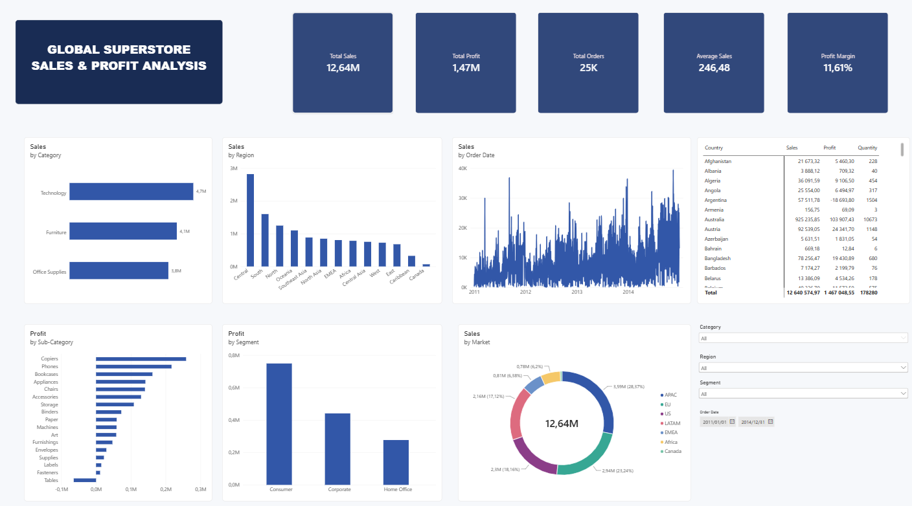

# Global Superstore Sales & Profit Analysis

## Project Overview
This project explores Global Superstore sales and profitability using a business intelligence dashboard. The dashboard summarises key performance indicators and compares performance by product category, region, order date, sub-category, market, customer segment, and country.

## Business Objective
The objective is to understand sales and profit performance, identify strong and weak areas of the business, and turn the findings into practical recommendations for decision-making.

## Dashboard Preview

## Key Performance Indicators
The dashboard displays the following headline metrics:
- **Total Sales:** approximately 12.64M
- **Total Profit:** approximately 1.47M
- **Total Orders:** approximately 25K
- **Average Sales:** approximately 246.48

*Note: The dashboard screenshot displays the Profit Margin card as 1.47M, which appears to repeat Total Profit rather than show a percentage. Verify the underlying measure before presenting this as a profit margin.*

## Five Key Business Insights
1. **Technology leads sales by category.** The dashboard shows approximately 4.7M in Technology sales, compared with approximately 4.1M for Furniture and 3.8M for Office Supplies.
2. **Central is the strongest sales region.** Central records approximately 2.8M in sales, ahead of South at around 1.6M.
3. **Consumer is the most profitable customer segment.** Consumer contributes approximately 0.75M in profit, compared with approximately 0.44M for Corporate and 0.28M for Home Office.
4. **Sales fluctuate over time.** The order-date chart shows substantial variation from 2011 to 2014, with stronger activity toward the end of the period.
5. **Profitability differs by sub-category.** Copiers and Phones are among the strongest profit contributors, while Tables show a negative profit contribution.

## Three Business Risks
1. **Unprofitable products:** Negative profit from Tables may reduce overall profitability if the underlying causes are not addressed.
2. **Concentration of performance:** The Central region and Consumer segment are strong contributors, so weaker performance in these areas could materially affect results.
3. **Sales variability:** Fluctuating sales may complicate inventory, cash-flow, and operational planning.

## Three Business Opportunities
1. **Grow Technology sales:** Investigate demand and product-level margins to build on the category's leading sales performance.
2. **Improve product profitability:** Review costs, pricing, discounting, and shipping for loss-making sub-categories such as Tables.
3. **Develop other regions and segments:** Use targeted campaigns and customer research to grow sales outside the strongest-performing region and segment.

## Recommendations
- Investigate drivers of performance in the Central region and share successful practices where relevant.
- Review product-level costs, pricing, discounts, and shipping for products with negative profit.
- Analyse seasonal and regional patterns to improve sales forecasting and inventory planning.
- Monitor both revenue and profit; high sales do not necessarily mean high profitability.
- Validate KPI definitions, especially the Profit Margin card, before publishing the dashboard.

## Tools and Skills Demonstrated
- Data analysis and interpretation
- Business Intelligence dashboarding
- KPI reporting
- Sales and profitability analysis
- Translating data findings into business risks, opportunities, and recommendations

## Repository Contents
- `README.md` — project overview, dashboard preview, insights, risks, opportunities, and recommendations
- `executive-summary.md` — concise executive summary report
- `images/global-superstore-dashboard.png` — dashboard screenshot

## Data Notes
The repository currently includes the dashboard screenshot and written analysis. Add the source dataset, cleaned data, workbook or BI project file, and any SQL/Python scripts if you want others to reproduce the analysis. Remove confidential or licensed data before publishing.
